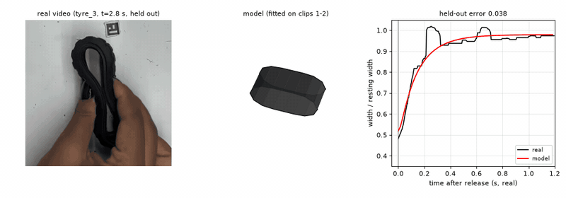
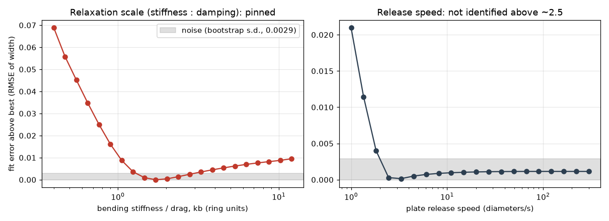

# How a squeezed rubber tyre springs back, fitted from video



*Two squeezes the model never saw (3x slow motion). Left: real. Middle: the fitted tyre, drawn with its lug rows, groove and stepped inner wall; the plates are the model's fingers. Right: width over time, real vs predicted. The model is given one number per squeeze, the squeezed width.*

**Setup.** A toy rubber tyre (75.8 mm across, 37 mm tread) is pinched to about half its width, held, and released. Top-down, 240 fps (checked from the 100 Hz room-light flicker, not assumed), a 10 mm ArUco marker for scale.

## What we found

1. **One video gives the recovery time, not stiffness and damping separately.** The tyre is overdamped (no overshoot), so only their ratio shows: **tau = 0.145 s** (bootstrap 95 % CI 0.129 to 0.165).
2. **A known force gives the scale.** A 333 g weight on the standing tyre sags it 7.6 mm: **0.43 N/mm**, so a damping of order 60 N s/m.
3. **The hand's release barely matters.** An instant release (no release parameter at all) predicts held-out squeezes within 0.001 of a fitted release speed.
4. **The rest is a floor.** Fitting each squeeze separately reaches 0.020; any shared model sits at 0.036 to 0.040, and every model family tried lands on the same number.

## The model in four equations

Measure the tyre's width in every frame and divide by its resting width, $z(t) = w(t)/w_\text{rest}$.

**Baseline (one time constant).** After release, with $z_0$ the squeezed width and $r$ the settled width:

$$z(t) = r - (r - z_0)\,e^{-t/\tau}$$

**Physical model (a ring).** The tyre cross-section is a ring of 16 nodes $\mathbf{x}_i$ with stretch springs, a bending energy on the turning angle $\theta_i$ (true large rotations, so it stiffens as it flattens) and penalty contact with two finger plates a gap $g$ apart:

$$E = \tfrac12 k_s\sum_i(\ell_i-\ell_0)^2 + \tfrac12 k_b\sum_i(\theta_i-\theta_0)^2 + \tfrac12 k_c\sum_i \max\!\big(0,\ |y_i|-\tfrac g2\big)^2$$

The rubber is overdamped (the 27 g mass is irrelevant), so the nodes simply flow down the energy:

$$c\,\dot{\mathbf{x}}_i = -\frac{\partial E}{\partial \mathbf{x}_i}$$

The plates close to the measured squeezed width, then open. Free parameters: $k_b/c$, the release speed, and the rest level $r$. Nothing is fitted per squeeze.

**3D.** Five of these rings stacked along the 37 mm tread, joined by axial springs $\tfrac12 k_a\sum(|\mathbf{X}_{s+1,i}-\mathbf{X}_{s,i}|-h)^2$, with a thicker wall on the lip side (the videos show a step inside) so that slice bending stiffness scales as wall$^3$. Plates touch the full width: the squeezes reach about 0.5 of the width, which partial contact cannot produce.

**Units.** $B = k_b\,\ell_0$ is the bending stiffness (EI); the weight test fixes it. Young's modulus follows from $E = 12\,B\,/\sum_i b_i t_i^3$ ($b$ = zone width, $t$ = wall).

## Predicting squeezes it has not seen

Fit on `tyre_1`, `tyre_2`; freeze; predict `tyre_3`, `tyre_4` (and leave-one-clip-out, LOCO). Error is the RMSE of $z$ (0.04 is about 3 mm). A flick is a squeeze held under 0.3 s.

| | no recovery | one time constant | ring / 3D model | LOCO: one time constant / ring |
|---|---|---|---|---|
| flicks included | 0.358 | 0.047 | not run | 0.045 / n.a. |
| flicks excluded | 0.343 | 0.036 | 0.040 | 0.032 / 0.034 |

Most of the drop from 0.047 to 0.036 comes from dropping flicks, not from a better model. The ring is not more accurate than the one-line exponential; what it adds is parameters in real units and a 3D shape. Its best variant (release speed depending on depth) reaches LOCO 0.029, but that gain is not statistically clear.

## What a video can and cannot tell you



*Fix one parameter, refit the others; grey is noise. Left: the stiffness-to-damping ratio is pinned. Right: release speed is not identified above about 2.5 diameters/s.*

For an overdamped rubber, $c\dot x=-kx$ gives $x(t)=x_0e^{-(k/c)t}$: scaling $k$ and $c$ together leaves the video unchanged, so only $k/c$ is observable. A known force breaks that tie.

Checks that go beyond the width (`code/extra_tests.py`):

* **It predicts the tyre's length too**, which was never fitted: error 0.063 on held-out squeezes against 0.103 and 0.208 for "no change". It gets the direction and about 60 % of the size.
* **No slow tail.** A fractional recovery $E_\alpha(-(t/\tau)^\alpha)$ fits to $\alpha=0.96$, the plain exponential.
* **Depth dependence is not geometry.** Shallow squeezes recover more slowly (correlation +0.82, 0.10 to 0.29 s), but the ring predicts the opposite sign and only 0.13 to 0.14 s. That leaves the hand's release or a strain-dependent rubber, which these clips cannot separate.
* **The ring is converged.** Going from 16 to 96 nodes (stiffness and drag rescaled) changes predictions by at most 0.005, below the 0.020 floor. The static weight calibration is not: the 16-node ring is about 20 % too soft, so the bending stiffness it gives may be about 20 % high.
* **Per-squeeze rest level does not help** (0.047, worse than a global rest level).

## What the model cannot do

Explain why shallow squeezes are slower; represent tread lugs, friction or out-of-plane bending (the wall is a thin-ring proxy); separate creep from permanent set. The wall of the thin side was not measured, and bending stiffness is 2.1e-3 to 5.6e-3 N m$^2$ depending on the ring used, so **Young's modulus is only known to "a few tenths to about 2 MPa"**. One tyre, one person, 12 usable squeezes. A caliper reading of the thin wall and a second weight would close most of the uncertainty; a tongs clip with a marker would measure the release.

## A second object: the pencil pouch (`pouch/`)

The hand covers the pouch while it is pressed, so recovery cannot be fitted. What can be measured is its shape with the hand off. On the red pouch (fixed camera) the body aspect is **0.414, 0.412, 0.411** before and after two 10 to 20 s handling episodes: a residual set under 0.5 % and no creep, so no detectable memory. The grey pouch cannot be separated from the wooden table by colour, so it has no result. Details in `pouch/README.md`.

## Reproduce

Python with numpy, scipy, opencv, matplotlib, numba (ffmpeg for the demo). Videos are read from `$TYRE_VIDEOS` (default `~/Documents`).

```
sh run.sh            # fits, tables and figures from the saved width signals (about 11 minutes)
sh run.sh extract    # first re-read the videos
sh run.sh demo       # also rebuild figures/demo.mp4 and demo.gif
sh run.sh extras     # length check, bootstrap CIs, fractional fit, depth test (about 5 minutes)
```

```
code/tyre_sig2.py          video -> width signal                code/tyre_ring_fast.py   the ring (numba)
code/tyre_fit2.py          squeeze events, one-time-constant    code/tyre_ring3d.py      the 3D stack
code/tyre_models_fast.py   all models, one protocol, bootstrap  code/identifiability.py  profile likelihood
code/extra_tests.py        length, CIs, fractional, depth       code/make_demo.py        the video and gif
load_and_hand/             weight test, Young's modulus, hand-tracking attempts
pouch/                     the pencil pouch                     docs/full_log.md         every experiment, including those that failed
```
